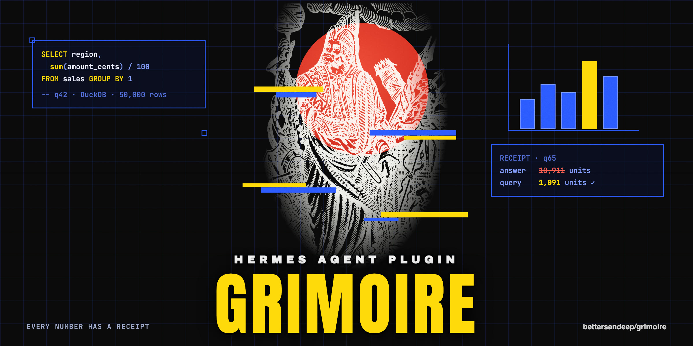

# Grimoire



A Hermes Agent plugin for learning and exploring data with fewer tokens.
Every number has a receipt.

Ask Hermes about a CSV, JSON, Parquet or SQLite file.
Grimoire opens it in DuckDB, answers with SQL, saves each query with an id like `q12`, and checks every number in the reply against the query results.

```
You:     What is the total revenue per region in ~/grimoire-bench/sales_50k.csv?
         amount_cents is in US cents. Answer in one short line, in millions of dollars.
Hermes:  North 2,905.17M; South 2,453.49M; West 1,993.43M; East 1,942.55M;
         north  304.38M; N. Region 93.79M [q42].
         ---
         Grimoire check: 0 of 6 numbers trace to query results. No source query for:
         2,905.17M · 2,453.49M · 1,993.43M · 1,942.55M · 304.38M · 93.79M.
         Verdict: needs revision.
```

A real answer (free model, 2026-11-09): the model forgot to divide cents by 100.
Query q42 says North made $29.05M, not $2,905M, and Grimoire flagged every number.

## Install

```sh
hermes plugins install bettersandeep/grimoire --enable
```

Hermes asks before it installs the one dependency, `duckdb`.
Needs Hermes 0.23.0 or later and Python 3.11 or later.
Update with `hermes plugins update grimoire`.

## Fastest setup: a Data bot

Most of the tokens in an answer are Hermes's own system prompt and tool list, sent with every model call (about 11,000 tokens, mostly cached).
A Data bot loads only Grimoire's tools, so each call sends about a fifth of that.
Your main agent keeps all its tools.
Grimoire never changes your settings; it only tells you how.

In Hermes Desktop:

1. Open the **Bots** tab, click **+**, then **New bot**. Name it data.
2. Click **Advanced** (below Description). Under **General**, clone from the profile that has Grimoire (usually default).
3. Open **Capabilities**, then **Tools**. Scroll down to the **Build for Hermes** box and switch off the switch in it: this switches off all tools.
   Then type `grimoire` in the search box and switch on **Grimoire**. Do the same for `clarif` (**Clarifying Questions**).
   Leave Skills off: it doubles the tokens of every call (measured: 2,214 to 4,532), and Grimoire adds the SQL recipe a question needs by itself.
4. Click **Create bot**, then ask data questions in the data bot's chat.

Already made a bot? Open its menu, choose **Edit…**, then **Advanced** and **Capabilities**.

In a terminal: `hermes chat -t grimoire,clarify`.

You do not need to remember this.
The first time a data answer comes from a chat with all of Hermes's tools, Grimoire adds one line with that chat's real numbers, for example "this chat sends 21 tools and about 13,138 tokens with every model call".
`/grimoire setup` shows the steps again, `/grimoire` shows the numbers for the current chat, and the Desktop Data page shows the steps until you hide them.

Same question, same free model, measured on 2026-11-09:

| | Hermes default tools | Data bot (Grimoire's tools only) |
|---|---|---|
| Tokens per answer | about 23,300 | about 4,300 (82% fewer) |
| Correct, 8 benchmark questions | 8 of 8 | 8 of 8 |
| Time per answer | 15 to 22 s | about 13 s |
| Time spent in Grimoire and DuckDB | under 0.3 s | under 0.3 s |

Almost all of the remaining time is the model writing; a faster model answers faster.
DuckDB runs these queries in 40 to 60 ms.

## What it does

| | |
|---|---|
| Reads files | CSV, TSV, JSON, NDJSON (also `.gz` and `.zst`), Parquet, SQLite; a folder or `sales_*.csv` pattern as one table |
| Answers in one step | When your message names a file, Grimoire opens it before the model starts, so the model answers with one query |
| Answers with SQL | DuckDB in memory; the model sees schemas and small results, never the rows |
| Saves receipts | Every query, its SQL and result, with an id the answer cites |
| Checks numbers | After each reply: which numbers trace to query results, which are derived by simple arithmetic, and which have no source |
| Checks the method | Under the answer: what the query left out ("left out 1,996 of 50,000 rows (empty amount)"), common mistakes (one value spelled two ways in the result, an incomplete last month, an average of averages, a join that counts rows twice, a rate compared across periods whose row counts differ a lot), which clock day and hour buckets use and a verdict: ready to share, share with caveats, or needs revision |
| Finds data problems | Malformed lines, duplicate rows, empty values, numbers or dates stored as text, spelling variants ('North' and 'north '), placeholder text ('N/A', '-'), placeholder numbers (9999), negative amounts, future dates, a column with one value; a health score out of 100 that lists every point taken off |
| Column statistics | Quantiles, outliers, top values, rows per month |
| Shape of the data | Which columns are dimensions, metrics and time; metrics that move together; ID columns that join to other attached files, with the share that matches |
| Explains changes | "Why did revenue drop in March?": the total change split by each category column, with each segment's share |
| Tests differences | "Is North really different from South, or chance?": Welch's t-test for averages, a two-proportion z-test for rates, with an exact p-value and plain words; it warns about small groups and that a difference is not a cause |
| Charts and reports | A bar chart in any chat; an HTML report where every number shows its SQL, with a file filter and search, tables that sort by any column, caveats under each result, and an "About the data" part (health, data problems, column notes, saved metrics). The chart fits the result: line for time, heatmap for two labels and a number (weekday by hour), histogram for equal buckets, scatter for two numbers, bars otherwise |
| Remembers | Files, column notes and merge rules across sessions |
| Stops raw reads | Blocks `read_file` on data files over 256 KB and points the model to Grimoire |
| Teaches (opt-in) | Plain words (default): how each answer was made, step by step, with the row count at each step and the result in context ("18.4% more than South"). SQL: one SQL idea per answer. Both end with a better question to ask next; optional "guess first" predictions |

## Commands

Type these in any Hermes chat. They run plugin code only, so they cost no tokens.

| Command | Does |
|---|---|
| `/grimoire` | Status: version, files, learning mode |
| `/grimoire sql q12` | The SQL and result behind a number |
| `/grimoire explain q12` | How your question became that SQL |
| `/grimoire chart q12` | A bar chart of a result |
| `/grimoire rerun q12` | Run the SQL again and check the result still holds |
| `/grimoire report [dataset]` | Save an HTML report of the last session's queries, or of one file's |
| `/grimoire define revenue = sum(amount_cents) / 100` | Save a metric; answers then compute "revenue" the same way every time |
| `/grimoire metrics` / `undefine <name>` | List or remove saved metrics |
| `/grimoire learn on` / `off` | Learning mode |
| `/grimoire learn plain` / `sql` | Lesson style: plain-words steps (default) or one SQL idea |
| `/grimoire learn predict on` / `off` | Guess the answer before you see it |
| `/grimoire rejects` | Malformed lines that were skipped |
| `/grimoire merges` | Merge rules, applied and waiting |
| `/grimoire merges approve` / `reject` | Apply or drop the merges the model proposed |
| `/grimoire unmerge <dataset> [column]` | Remove merge rules |
| `/grimoire forget <dataset>` | Delete everything saved about one file |
| `/grimoire clear history` | Delete all saved queries and results |
| `/grimoire reset confirm` | Delete everything Grimoire saved |
| `/grimoire setup` | How to use fewer tokens with a Data bot |

## Hermes Desktop

Grimoire adds a **Data** page to Hermes Desktop: your files with their size, health and data problems, merges waiting for approval, learning toggles, and every saved query.
Each query has tabs for Chart, Table, SQL and How it was made.
You can switch the chart type (bars, columns, line, area, donut) and pick which number to show; hover a mark to see its value.
Tables keep the same decimals in a column and show a bar behind each number.
Small files (up to 1,000,000 rows) get a health check as soon as you name them.
Like every Desktop plugin it starts off; turn it on under **Capabilities → Plugins**.

## Tools the model gets

`grimoire_attach`, `grimoire_profile`, `grimoire_query`, `grimoire_drivers`, `grimoire_compare`, `grimoire_note`, `grimoire_merge`, `grimoire_catalog`, and the skill `grimoire:explore-data`.

## Benchmark

Same 8 questions on the same free model, with and without Grimoire ([details](bench/RESULTS.md)), measured on 2026-11-09 with Grimoire 0.19:

| | Plain Hermes | Hermes with Grimoire | Data bot |
|---|---|---|---|
| Correct | 8 of 8 | 8 of 8 | 8 of 8 |
| Input tokens (median) | 65,362 | 23,572 (64% fewer) | 4,436 (93% fewer) |
| Time per answer | 33 s | 15 s | 16 s |
| Cost per answer, at $3/$15 per million | $0.046 | $0.024 | $0.013 |
| Tool calls | 4 | 1 | 1 |

One Data bot answer wrote a stray "25,000" before correcting itself to 2,500 customers; the number check flagged it.

Run it yourself with `bench/make_data.py` and `bench/run.py`; the example above uses `sales_50k.csv` from it.

On real public data, NYC taxi trips January to June 2024 (20.3M rows, 6 Parquet files), with Grimoire 0.19:

| | Plain Hermes | Hermes with Grimoire | Data bot |
|---|---|---|---|
| Correct | 6 of 6 | 6 of 6 | 6 of 6 |
| Input tokens (median) | 123,437 | 23,866 | 5,037 (96% fewer) |
| Time per answer | 75 s | 12 s | 12 s |
| Tool calls | 10 | 1 | 1 |

The 2 GB CSV of the same rows gives the same picture ([details](bench/RESULTS.md)).
Run it with `bench/run.py run --set nyc --sizes parquet,csv --setups plain,grimoire,databot`.

## What it can access, and what it stores

- **Files:** only the files the model attaches, read only. Inside DuckDB, all other file access, network access, extension loading and setting changes are off and locked.
- **Private folders:** files in `~/.hermes`, `~/.ssh`, `~/.gnupg`, `~/.aws`, `~/.config`, `~/.kube`, `~/.docker` and `~/Library` are refused (iCloud Drive and other cloud folders in `~/Library` are allowed). To allow them, set `plugins.entries.grimoire.settings.allow_private_folders: true`.
- **Your files never change.** Merge rules apply inside Grimoire only.
- **Reports** are written to `~/.hermes/plugin-data/grimoire/reports/` only when you run `/grimoire report`.
- **Opening files before the model starts:** when your message names a data file that exists, Grimoire opens it (read only, same rules as above) and gives the model its table name and columns.
- **Stored in** `~/.hermes/plugin-data/grimoire/data.db`: file paths, column types and profiles, your column notes, merge rules, settings, and every query with up to 200 result rows and the question that led to it. Delete with `/grimoire forget`, `clear history` or `reset confirm`. Hermes keeps its own chat history, which also contains tool results.
- **Network:** none. Grimoire makes no network calls; your model provider sees what the model sees, as with any Hermes tool.
- **Hooks:** `pre_tool_call` (blocks raw reads of large data files), `pre_llm_call` (adds a one-line hint when a message names a data file, and the prediction prompt when that is on), `post_tool_call` (reads your answer to a prediction question), `transform_llm_output` (adds the number check and, when on, the learning card), `pre_api_request` and `post_api_request` (keep two numbers per model call in memory, the tool count and the provider's input token count, to show what a chat costs; no message content).
- **Limits:** queries stop after 30 s; DuckDB may use half of your memory; results are capped at 200 rows; SQLite files over 2 GB are refused.

## Safety

- Only one SELECT statement per query, decided by DuckDB's own parser.
- The model can propose merging values, but only you can apply it (`/grimoire merges approve`).
- Tool results tell the model that file values are data, not instructions. A file can still contain text that tries to steer the model; review answers about files you did not create.
- Security review: [findings and fixes](https://github.com/bettersandeep/grimoire/pull/18).

## Known limits

- The number check reads digits only. Number words ("three") and text claims (names, rankings) are not checked.
- A small number can match a query value by chance.
- Plain powers of ten (100, 1000) are skipped as claims, because they are usually unit factors.
- Numbers from two arithmetic steps, or from a query the answer does not cite, are flagged even when right. In the benchmark replay, 3 of 40 correct answers had a flag.
- Session values live in memory; after a restart only cited query ids are checked.
- Profiles of tables over 1 million rows use a 1 million row sample.
- Excel files are not supported, because DuckDB would need to download an extension. Save as CSV.

## Development

```sh
python -I selftest.py                         # needs duckdb
hermes plugins validate . --install-deps
```

MIT license.

## Credits

The icon and banner use Howard Pyle's public-domain drawing "The Enchanter Merlin" (1903); see [assets/CREDITS.md](assets/CREDITS.md).
