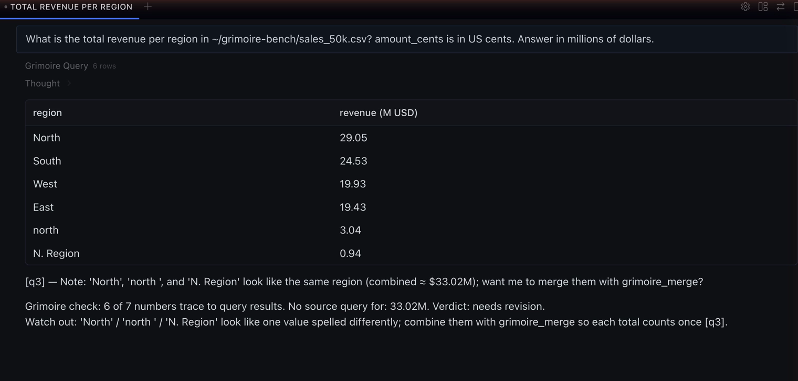
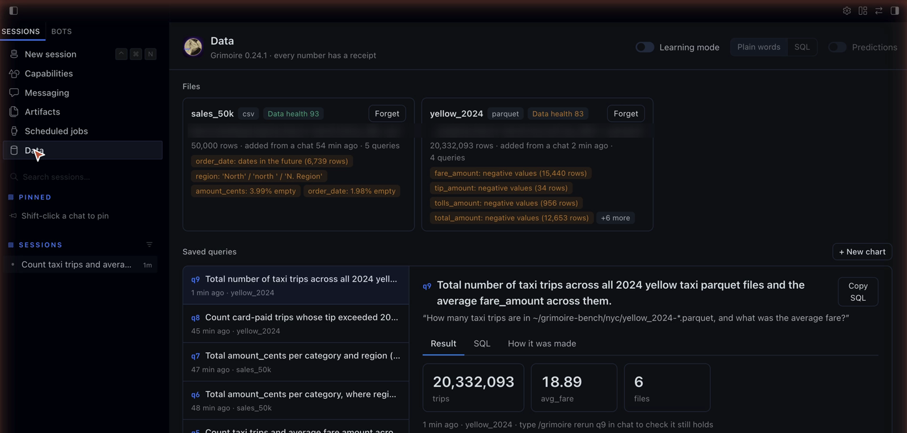
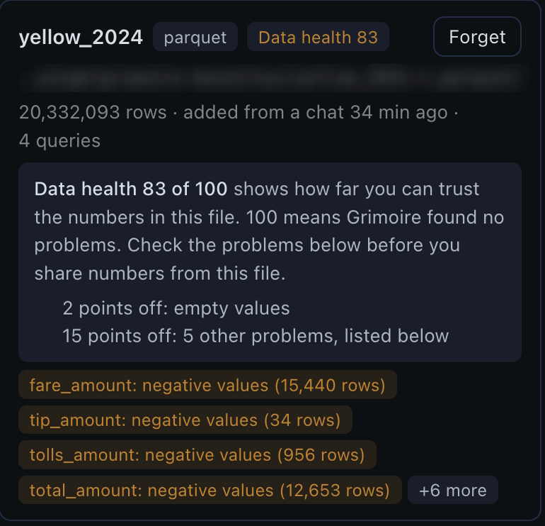
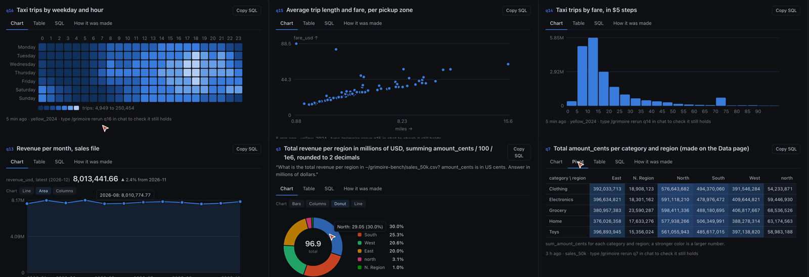
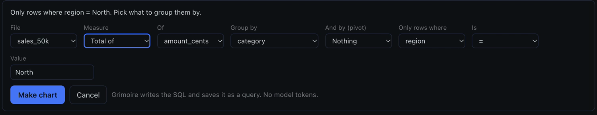
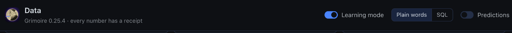
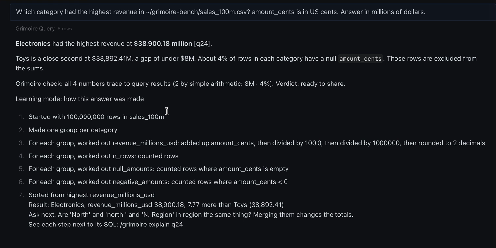
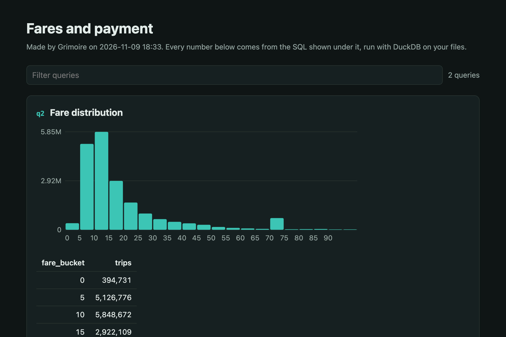
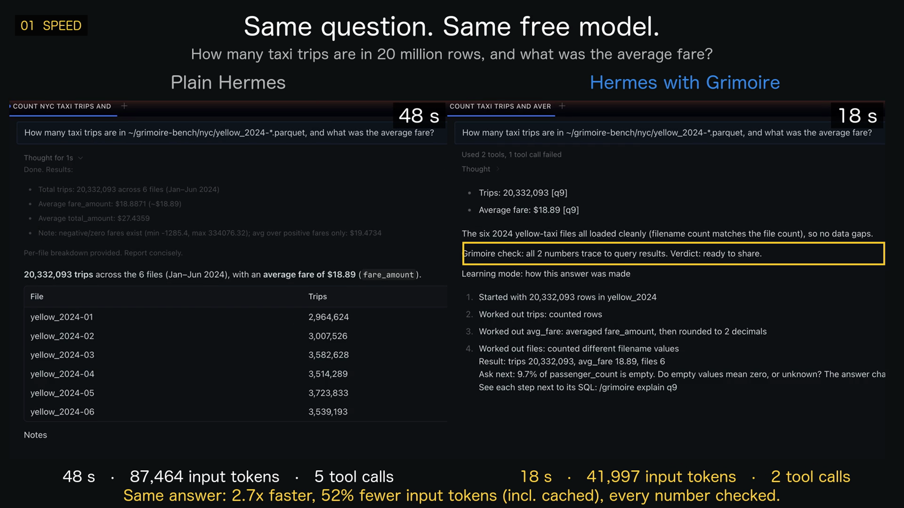

# Grimoire


Ask Hermes about your data files, and get answers that are fast, cheap and checked.
Every number has a receipt.

- **Fast on big files:** DuckDB answers with one SQL query, so the model never reads your rows.
  100 million rows in a 5 GB CSV: 12 s instead of 182 s, same question, same model (Claude Sonnet 5.5).
- **Fewer tokens:** about 35,500 input tokens per answer on Claude Haiku, Sonnet and Opus 5.5, with 2 model calls.
  That is 17% to 56% fewer than plain Hermes in 15 of 18 benchmark tests.
- **Checked:** after each reply, Grimoire checks every number against the query results and flags the ones with no source.
- **Study your data with 0 tokens:** a Data page in Hermes Desktop with ten chart views, pivots, drill-down and a health score for each file.
  Plugin code makes all of it, with no model call.
- **Learn as you go, 0 tokens:** learning mode shows how each answer was made, step by step, in plain words or SQL.

Works with CSV, TSV, JSON, NDJSON (also `.gz` and `.zst`), Parquet and SQLite files, and with a folder or pattern such as `sales_*.csv` read as one table.

## Contents

- [Quick start](#quick-start)
- [Ask in chat](#ask-in-chat)
- [The Data page](#the-data-page)
- [Modes](#modes)
- [Commands](#commands)
- [Speed and tokens](#speed-and-tokens)
- [All features](#all-features)
- [What it can access, and what it stores](#what-it-can-access-and-what-it-stores)

## Quick start

1. **Install** in a terminal:

   ```sh
   hermes plugins install bettersandeep/grimoire --enable
   ```

   Hermes asks before it installs the one dependency, `duckdb` (1.4.2 or later, 2.x works).
   You need Hermes 0.23.0 or later and Python 3.11 or later.
   Update later with `hermes plugins update grimoire`.

2. **Turn on the Data page** in Hermes Desktop (optional).
   Open **Capabilities**, then **Plugins**, search for `grimoire`, and switch it **On**.
   A **Data** entry appears in the sidebar.

3. **Ask about a file** in any chat, with its path:

   ```
   How many taxi trips are in ~/data/yellow_2024-*.parquet, and what was the average fare?
   ```

   Grimoire opens the file before the model starts, the model answers with one query, and a check line appears under the answer.

## Ask in chat

Name a data file in your message and ask your question in plain words.
You do not need to set anything up, and all your other Hermes tools keep working.



Each answer cites its query, like `[q3]`.
Under the answer, Grimoire adds its check:

| Line | Means |
|---|---|
| `Grimoire check: all 2 numbers trace to query results` | Every number in the reply comes from a query result, or from simple arithmetic on numbers the reply shows |
| `No source query for: 2,000` | The model wrote a number that no query produced, for example a rounded or made-up count |
| `Check how these were worked out: …` | The number only matches by combining two values the reply does not show, so it may be a coincidence |
| `Not from a cited query: 137` | The number is in another result of this chat, but not in a query the answer cites, so it may be a coincidence |
| `Assumes: left out 1,996 of 50,000 rows (empty amount)` | What the query's filters dropped |
| `Watch out: 'North' / 'north ' / 'N. Region' look like one value…` | A common mistake in the method or the data |
| `Watch out: 12.5% is written as a rise, but the result is negative` | The answer says "grew" or "up", and the query result is below zero |
| `Verdict: ready to share`, `share with caveats`, `needs revision` | The summary of the check |

A real example: on a free model, the model once forgot to divide cents by 100 and reported North at $2,905M.
Query q42 said $29.05M, and Grimoire flagged every number in the reply.
In the benchmark, plain Hermes on Claude Opus 5.5 made the opposite mistake: it divided by 100 twice, so every region total was 100 times too small.

To see the SQL and result behind any number, type `/grimoire sql q3`.

## The Data page

Hermes Desktop gets a **Data** page with your files, every saved query, and the learning switches.
Everything on this page runs on your computer and uses no model tokens.



### Data health

Each file gets a score out of 100 for how far you can trust its numbers.
Click the score to see every point taken off and what to do about it.



Grimoire looks for malformed lines, duplicate rows, empty values, numbers stored as text, one value written in different ways, placeholders such as 'N/A' or 9999, negative amounts and future dates.
Files up to 1,000,000 rows are checked as soon as you name them; the Data page checks larger ones when you open it.

### Charts

Every saved query opens with a chart that fits its result, with tabs for **Chart**, **Table**, **SQL** and **How it was made**.
One click switches the chart type, and hovering a mark shows its value.



| Result shape | Chart |
|---|---|
| A date and a number | Line or area, with the latest value and its change |
| A label and a number | Bars, columns or donut (up to 6 parts) |
| Two labels and a number | Heatmap and pivot table |
| Equal buckets and counts | Histogram |
| Two numbers | Scatter |
| One row of numbers | Number tiles |

Tables keep the same decimals in a column and show a bar behind each number.

### New chart and drill-down

Click **+ New chart** to make a chart without the model.
Pick a file, a measure (count, total, average, smallest, largest), what to group by (a column, or a date per day, month or year), an optional second group for a pivot, and an optional filter.
Grimoire writes the SQL, runs it, and saves it as a query, so it can be checked like any answer.

Click a bar, column or slice to look inside it: the form opens with that value as the filter.



## Modes

### Normal chat (default)

Grimoire works in any chat, next to your other tools.
Nothing to switch on.

### Learning mode

Learning mode adds a card under each answer that explains how it was made.
Switch it on with the **Learning mode** switch on the Data page, or type `/grimoire learn on`.



| Style | Switch | The card shows |
|---|---|---|
| Plain words (default) | **Plain words** on the Data page, or `/grimoire learn plain` | Each step with its row count ("Kept rows where …: 48,004 rows"), the result in context ("18.4% more than South"), and a better question to ask next |
| SQL | **SQL** on the Data page, or `/grimoire learn sql` | One SQL idea per answer, taken from the query that produced it |
| Predictions | **Predictions** on the Data page, or `/grimoire learn predict on` | Grimoire asks you to guess the main number first, then scores your guess |



`/grimoire explain q12` shows each step next to its SQL.
Turn learning mode off with the same switch or `/grimoire learn off`.

### Optional: a lean Data bot

Hermes sends its system prompt and every tool with each model call.
A Desktop bot with only Grimoire's tools sends about a fifth of that.
You do not need this; it only saves tokens.

1. In Hermes Desktop, open **Bots**, click **+**, then **New bot**. Name it data.
2. Click **Advanced**, and under **General** clone from the profile that has Grimoire.
3. Open **Capabilities**, then **Tools**. Switch off the switch in the **Build for Hermes** box (all tools), then switch on **Grimoire** and **Clarifying Questions**.
4. Click **Create bot**.

In a terminal, the same setup is `hermes chat -t grimoire,clarify`.
`/grimoire setup` shows these steps, and `/grimoire` shows the tools and tokens of the current chat.

## Commands

Type these in any Hermes chat.
They run plugin code only, so they cost no tokens.

| Command | Does |
|---|---|
| `/grimoire` | Status: version, files, learning mode, tokens of this chat |
| `/grimoire sql q12` | The SQL and result behind a number |
| `/grimoire explain q12` | How your question became that SQL |
| `/grimoire chart q12` | A bar chart of a result, in the chat |
| `/grimoire rerun q12` | Run the SQL again and check the result still holds |
| `/grimoire report [file]` | Save an HTML report of the last session's queries, or of one file's |
| `/grimoire define revenue = sum(amount_cents) / 100` | Save a metric, so "revenue" is computed the same way every time |
| `/grimoire metrics`, `/grimoire undefine <name>` | List or remove saved metrics |
| `/grimoire learn on`, `off`, `plain`, `sql` | Learning mode and its style |
| `/grimoire learn predict on`, `off` | Guess the answer before you see it |
| `/grimoire rejects` | Malformed lines that were skipped |
| `/grimoire merges`, `merges approve`, `merges reject` | See, apply or drop merges the model proposed (for example 'north ' into 'North') |
| `/grimoire unmerge <file> [column]` | Remove merge rules |
| `/grimoire forget <file>` | Delete everything saved about one file |
| `/grimoire clear history` | Delete all saved queries and results |
| `/grimoire reset confirm` | Delete everything Grimoire saved |
| `/grimoire setup` | How to set up the optional Data bot |

The HTML report shows every number with its SQL, sortable tables, the right chart for each result, caveats, and an "About the data" part.



## Speed and tokens

One real run in Hermes Desktop: the same question on 100 million rows (a 5 GB CSV), the same model, Claude Sonnet 5.5.



The benchmark repeats this with 8 questions per file on Claude Haiku, Sonnet and Opus 5.5, with medians ([all results](bench/RESULTS.md)).
Input tokens include cached tokens.

| | Plain Hermes | Hermes with Grimoire |
|---|---|---|
| Correct answers, 132 questions on 3 models | 131 | 132 |
| Time per answer, 100M-row CSV (Sonnet) | 170 s | 9 s |
| Time per answer, 100M-row Parquet (Sonnet) | 8 s | 5 s |
| Input tokens per answer, 100M-row CSV (Opus) | 69,865 | 35,466 (49% fewer) |
| Input tokens per answer, taxi Parquet (Sonnet) | 34,138 | 35,958 (5% more) |
| Model calls per answer | 2 to 4 | 2 |
| Number check, charts, pivots, learning cards | not built in | built in, 0 tokens |

Grimoire is fastest against plain Hermes on large CSV files (5x to 19x); on Parquet plain Hermes is closer (1.2x to 2.5x).
On most tests Grimoire uses fewer tokens; in 3 of 18 tests plain Hermes used up to 5% fewer.
The optional Data bot, with only Grimoire's tools, used 4,400 to 5,000 input tokens per answer in an earlier run on a free model.
Run the benchmark yourself with `bench/make_data.py` and `bench/run.py`.

## All features

| | |
|---|---|
| Answers in one step | When your message names a file, Grimoire opens it before the model starts, so the model answers with one query |
| Answers with SQL | DuckDB in memory; the model sees table names, columns and small results, never the rows |
| Saves receipts | Every query, its SQL and result, with an id the answer cites |
| Checks numbers | Which numbers trace to query results, which come from simple arithmetic, and which have no source |
| Checks the method | Rows a filter left out, one value spelled two ways, an incomplete last period, an average of averages, a join that counts rows twice, a rate compared across periods with very different row counts, and the clock that day and hour buckets use |
| Finds data problems | See [Data health](#data-health); a score out of 100 with every point explained |
| Column statistics | Quantiles, outliers, top values, rows per month |
| Shape of the data | Dimensions, metrics and time columns; metrics that move together; ID columns that join to other files |
| Explains changes | "Why did revenue drop in March?": the change split by each category column |
| Tests differences | "Is North really different from South?": Welch's t-test or a two-proportion z-test, in plain words |
| Remembers | Files, column notes, merge rules and saved metrics across sessions |
| Stops raw reads | Blocks `read_file` on data files over 256 KB and points the model to Grimoire |

The model gets these tools: `grimoire_attach`, `grimoire_profile`, `grimoire_query`, `grimoire_drivers`, `grimoire_compare`, `grimoire_note`, `grimoire_merge`, `grimoire_catalog`, and the skill `grimoire:explore-data`.

## What it can access, and what it stores

- **Files:** only the files you or the model name, read only. Inside DuckDB, all other file access, network access, extension loading and setting changes are off and locked.
- **Private folders:** files in `~/.hermes`, `~/.ssh`, `~/.gnupg`, `~/.aws`, `~/.config`, `~/.kube`, `~/.docker` and `~/Library` are refused (iCloud Drive and other cloud folders in `~/Library` are allowed). To allow them, set `plugins.entries.grimoire.settings.allow_private_folders: true`.
- **Your files never change.** Merge rules apply inside Grimoire only.
- **SQLite files** are copied to a temporary folder as CSV, once per file version, and loaded into DuckDB from there.
- **Reports** are written to `~/.hermes/plugin-data/grimoire/reports/` only when you run `/grimoire report`.
- **Stored in** `~/.hermes/plugin-data/grimoire/data.db`: file paths, column types and profiles, your column notes, merge rules, settings, and every query with up to 200 result rows and the question that led to it. Delete with `/grimoire forget`, `clear history` or `reset confirm`. Hermes keeps its own chat history, which also contains tool results.
- **Network:** none. Your model provider sees what the model sees, as with any Hermes tool.
- **Shell commands, background processes, credentials and telemetry:** none.
- **Hooks:** `pre_tool_call` (blocks raw reads of large data files), `pre_llm_call` (opens a named data file and adds its table and columns; the prediction prompt when that is on), `post_tool_call` (reads your answer to a prediction question), `transform_llm_output` (adds the check and, when on, the learning card), `pre_api_request` and `post_api_request` (keep the tool count and input token count of each model call in memory for `/grimoire`; no message content).
- **Limits:** queries stop after 30 s; the chat's DuckDB may use half of your memory and the Data page's an eighth per file; results are capped at 200 rows; SQLite files over 2 GB are refused.

## Safety

- Only one SELECT statement per query, decided by DuckDB's own parser.
- The model can propose merging values, but only you can apply them (`/grimoire merges approve`).
- Table, column and value names from a file reach the model marked as data, and long values are cut. A file can still contain text that tries to steer the model; review answers about files you did not create.
- Security reviews: [first review](https://github.com/bettersandeep/grimoire/pull/18), [fixes from the second review and the Hermes security scan](https://github.com/bettersandeep/grimoire/pull/84).

## Known limits

- The check reads digits only. Number words ("three") and text claims (names, rankings) are not checked.
- A small number can match a query value by chance; numbers that only match by combining hidden values are marked for a check.
- Numbers from two arithmetic steps, or from a query the answer does not cite, are flagged even when right.
- An answer that cites no query is checked against every result of the chat, which is a wider net.
- Session values live in memory; after a restart only cited query ids are checked.
- Profiles of tables over 1 million rows use a 1 million row sample.
- Excel files are not supported, because DuckDB would need to download an extension. Save as CSV.

## Development

```sh
python -I selftest.py                         # needs duckdb
hermes plugins validate . --install-deps
```

CI runs the self-test on Python 3.11 with DuckDB 1.4.2, and on Python 3.13 with DuckDB 1.5 and 2.x.

MIT license.

## Credits

The icon and banner use Howard Pyle's public-domain drawing "The Enchanter Merlin" (1903); see [assets/CREDITS.md](assets/CREDITS.md).
